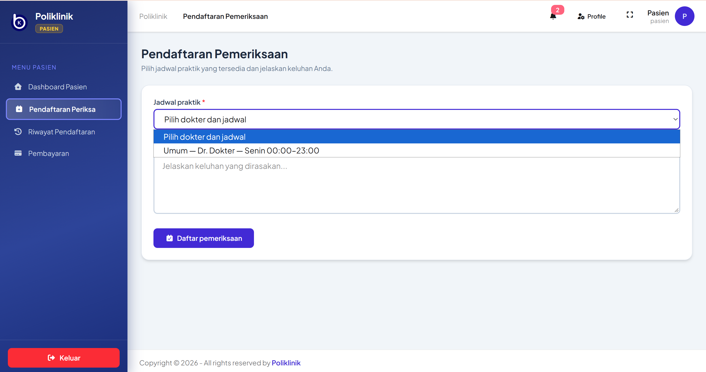
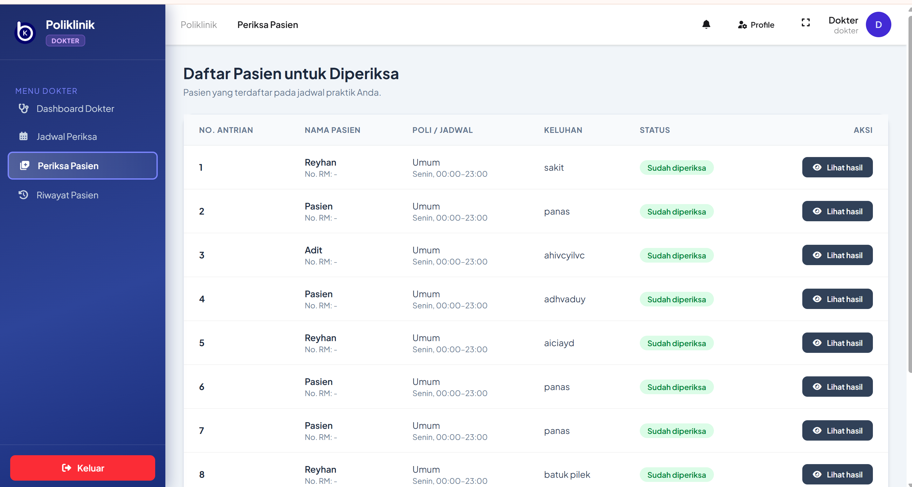
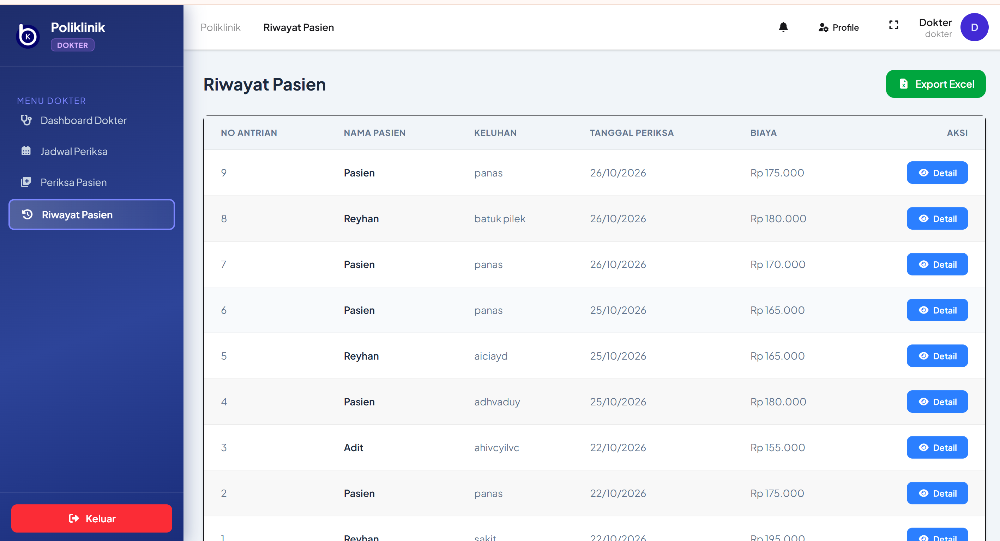

<p align="center"><a href="https://laravel.com" target="_blank"></a></p>

<p align="center">
<a href="https://github.com/laravel/framework/actions"></a>
<a href="https://packagist.org/packages/laravel/framework"></a>
<a href="https://packagist.org/packages/laravel/framework"></a>
<a href="https://packagist.org/packages/laravel/framework"></a>
</p>

## About Laravel

Laravel is a web application framework with expressive, elegant syntax. We believe development must be an enjoyable and creative experience to be truly fulfilling. Laravel takes the pain out of development by easing common tasks used in many web projects, such as:

- [Simple, fast routing engine](https://laravel.com/docs/routing).
- [Powerful dependency injection container](https://laravel.com/docs/container).
- Multiple back-ends for [session](https://laravel.com/docs/session) and [cache](https://laravel.com/docs/cache) storage.
- Expressive, intuitive [database ORM](https://laravel.com/docs/eloquent).
- Database agnostic [schema migrations](https://laravel.com/docs/migrations).
- [Robust background job processing](https://laravel.com/docs/queues).
- [Real-time event broadcasting](https://laravel.com/docs/broadcasting).

Laravel is accessible, powerful, and provides tools required for large, robust applications.

## Learning Laravel

Laravel has the most extensive and thorough [documentation](https://laravel.com/docs) and video tutorial library of all modern web application frameworks, making it a breeze to get started with the framework. You can also check out [Laravel Learn](https://laravel.com/learn), where you will be guided through building a modern Laravel application.

If you don't feel like reading, [Laracasts](https://laracasts.com) can help. Laracasts contains thousands of video tutorials on a range of topics including Laravel, modern PHP, unit testing, and JavaScript. Boost your skills by digging into our comprehensive video library.

## Laravel Sponsors

We would like to extend our thanks to the following sponsors for funding Laravel development. If you are interested in becoming a sponsor, please visit the [Laravel Partners program](https://partners.laravel.com).

### Premium Partners

- **[Vehikl](https://vehikl.com)**
- **[Tighten Co.](https://tighten.co)**
- **[Kirschbaum Development Group](https://kirschbaumdevelopment.com)**
- **[64 Robots](https://64robots.com)**
- **[Curotec](https://www.curotec.com/services/technologies/laravel)**
- **[DevSquad](https://devsquad.com/hire-laravel-developers)**
- **[Redberry](https://redberry.international/laravel-development)**
- **[Active Logic](https://activelogic.com)**

## Contributing

Thank you for considering contributing to the Laravel framework! The contribution guide can be found in the [Laravel documentation](https://laravel.com/docs/contributions).

## Code of Conduct

In order to ensure that the Laravel community is welcoming to all, please review and abide by the [Code of Conduct](https://laravel.com/docs/contributions#code-of-conduct).

## Security Vulnerabilities

If you discover a security vulnerability within Laravel, please send an e-mail to Taylor Otwell via [taylor@laravel.com](mailto:taylor@laravel.com). All security vulnerabilities will be promptly addressed.

## License

The Laravel framework is open-sourced software licensed under the [MIT license](https://opensource.org/licenses/MIT).

## Poliklinik Fast Track

Fast Track adds a patient queue dashboard with Reverb/Echo live updates, patient registration history, prescription payments and admin verification, database notifications, password changes, and Excel-compatible exports.

### Local setup

The current project manifest targets Laravel 12 and PHP 8.2. Install the dependencies and prepare the environment:

```powershell
Copy-Item .env.example .env
composer install
npm install
php artisan key:generate
php artisan migrate
npm run build
```

Run the application and its development services with:

```powershell
composer run dev
```

The development command starts Laravel, the queue worker, logs, Vite, and the Reverb WebSocket server. Queue broadcasts are asynchronous, so calling a patient still succeeds if Reverb is temporarily unavailable; live updates resume when Reverb is running. To use a separate Reverb server, set `REVERB_HOST` and `REVERB_PORT` to the same host and port used by the server. The example environment uses local Reverb credentials; replace them with unique values outside local development. Payment proof files are stored on Laravel's private local disk and are only served through the admin verification route.

Exports are delivered as Excel-compatible SpreadsheetML `.xls` files, so the export feature does not require PHP's optional GD or ZIP extensions.

### Database updates

Run `php artisan migrate` after pulling the Fast Track changes. New migrations add medicine stock and queue state, payment records, and Laravel's database notifications table. Existing completed examinations are migrated to the completed queue state.

### Laravel version note

The Fast Track brief names Laravel 13, but this repository currently requires Laravel 12 and the available PHP runtime is 8.2. The feature work keeps the existing supported runtime intact rather than attempting an incompatible framework upgrade.

## Dokumentasi Fitur Aplikasi

### 1. Daftar Poli (Pasien)


### 2. Periksa Pasien (Dokter)


### 3. Riwayat Pasien (Dokter)
